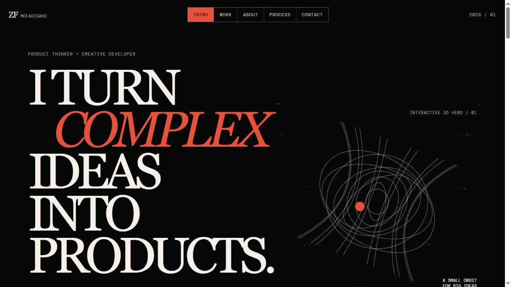

# 朱飞阳 / Mofarigano



一个面向产品设计、研究、AI 应用与创意开发的个人作品集网站。

## 设计概念

这个网站把个人作品集做成一段“从复杂问题到可用产品”的视觉叙事。整体语言参考实验性编辑设计、Swiss Editorial、Neo-Brutalism 和 Immersive Web，但内容与视觉资产均为朱飞阳个人品牌定制。

- **黑色作为工作台**：让大字、项目索引和线框 Orb 成为主要视觉焦点。
- **珊瑚红作为行动色**：用于当前导航、重点标题、项目强调和联系入口。
- **电蓝作为思考空间**：用于宣言区，表达研究、探索和开放性。
- **衬线大字 + 等宽小字**：大字负责建立记忆，小字负责提供项目状态、年份和结构化信息。
- **一页式滚动叙事**：Intro → Work → About → Process → Contact，把个人定位、项目证据、工作方法和联系方式串成连续路径。
- **局部 3D 而非全站 3D**：Canvas 线框 Orb 只承担 Hero 和 Contact 的视觉记忆点，保持页面轻量和可维护。

## 动效系统

- 橙红色页面加载转场
- Split Text Reveal 首屏文字进入
- Scroll Progress Indicator 页面进度条
- Scroll Reveal / Blur Reveal 区块进入
- Sticky Scrollytelling 流程区
- 3D Tilt Hover 与 Spotlight Card 项目卡
- Project Detail Overlay 项目详情层
- Magnetic Email CTA 与点击复制
- `prefers-reduced-motion` 降级支持

## 内容结构

1. **Intro**：产品思维、AI、数学和工程之间的个人定位。
2. **Selected Work**：Lingo、TAP、Credit Explained、PACT、CookIdea、Fastyle NailBot 六个项目。
3. **About**：导师助理、Two Sigma 量化研究、阿里巴巴 HR、全栈产品与跨学科经历。
4. **Process**：Question → Model → Prototype → Ship。
5. **Contact**：`2389380094@qq.com`，支持 mailto 和一键复制。

## Run locally

```bash
npm install
npm run dev
```

## Validate

```bash
npm run build
npm run test:sites
```

Contact: 2389380094@qq.com
